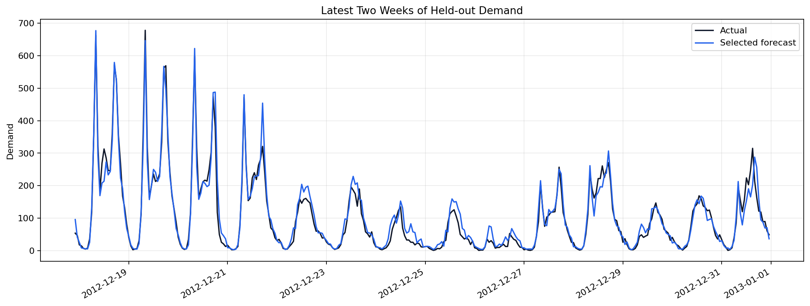
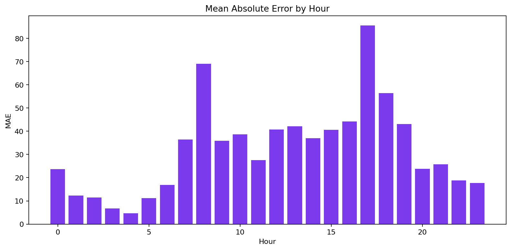
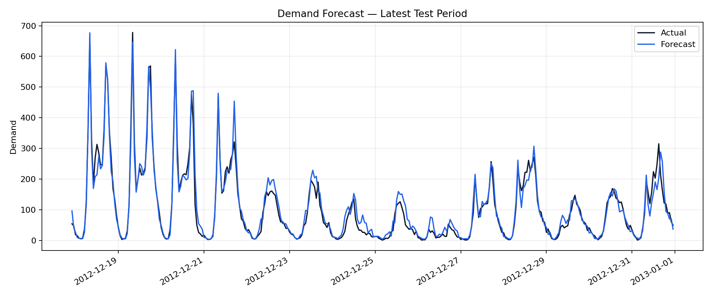

# Demand Forecasting with Historical Features

**Author:** Mohammed Adeen Shaik  
**Review date:** 11 October 2026

## Research question

Does gradient boosting improve demand error over a seasonal baseline in chronological evaluation?

## Data and provenance

UCI Bike Sharing data, used as a demand-planning teaching example.

Source materials are linked from the repository README. Input fingerprints are recorded in [the evidence manifest](evidence.json) so a reader can identify the exact committed artifacts used in this review.

## Method and analytical rationale

Earlier periods train the model, the next period selects it and the last period measures error. Lag and rolling statistics use earlier observed targets.

## Findings and interpretation

Fresh execution on 11 October 2026 using the committed pipeline and random seed 42. Validation selected **gradient_boosting**. On 2,582 later-period rows, selected-model MAE was **32.19** and seasonal-naive MAE was **85.74**, a **62.5%** reduction. This is rolling one-step evaluation using observed prior targets, not an advance multi-step forecast.

| Measure | Value |
|---|---:|
| selected model | gradient_boosting |
| seasonal lag | 168 |
| train rows | 12047 |
| validation rows | 2582 |
| test rows | 2582 |
| random seed | 42 |

| Test model | MAE | RMSE | sMAPE |
|---|---:|---:|---:|
| test_gradient_boosting | 32.19 | 51.45 | 0.221 |
| test_seasonal_naive | 85.74 | 149.41 | 0.456 |
| test_selected | 32.19 | 51.45 | 0.221 |

## Limitations

This is rolling one-step evaluation with observed history, not a multi-step forecast from a single origin. Weather variables may be observed rather than known in advance. Row-based lags can differ from calendar-hour lags when timestamps are missing. Bike rentals are not actual retail SKU sales.

## Reproduction

Use the setup commands and input contract in the [repository README](https://github.com/Adeen1607/retail-demand-forecasting#readme). Open the [notebook catalogue](notebooks.html) for annotated code and saved outputs. Keep raw records and model binaries local; public reports contain aggregate results or source-embedded figures.

## Final visual results

*Figure from key_visuals.ipynb, original code cell 3.*

*Figure from key_visuals.ipynb, original code cell 4.*

*Held-out evaluation figure: forecast_vs_actual.png.*

